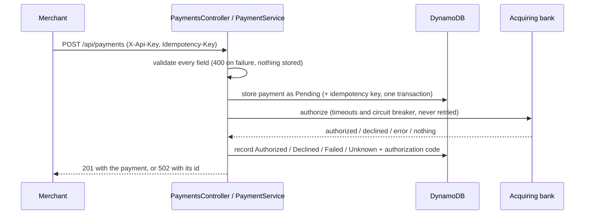

# Payment Gateway API

[](https://github.com/cusnirati/payment-gateway-api/actions/workflows/ci.yml)

A payment gateway in ASP.NET Core (.NET 10): merchants submit card payments, the gateway
validates them, asks an acquiring bank to authorize them, records the outcome in DynamoDB and
lets the merchant read it back. The bank is simulated with WireMock.

The interesting part is what happens when things go wrong. The gateway never charges a card
without a record of it, never retries a charge on its own, lets merchants retry safely with an
`Idempotency-Key`, and tells merchants whether a failure was theirs or the bank's.

## Quick start

Requirements: the .NET 10 SDK and Docker.

```bash
cd src && docker compose --profile api up -d --build --wait   # DynamoDB Local, the bank simulator, the api on :5067
```

```bash
curl -i -X POST http://localhost:5067/api/payments \
  -H "X-Api-Key: dev-key-merchant-a" \
  -H "Content-Type: application/json" \
  -H "Idempotency-Key: order-1001" \
  -d '{"cardNumber":"2222405343248873","expiryMonth":4,"expiryYear":2030,"currency":"GBP","amount":1050,"cvv":"123"}'
```

To debug the api instead of running its container, start only the dependencies and run it
from the SDK (Swagger UI at http://localhost:5067/swagger):

```bash
cd src && docker compose up -d
export AWS_ACCESS_KEY_ID=local AWS_SECRET_ACCESS_KEY=local   # DynamoDB Local ignores them, the AWS SDK insists on some
dotnet run --project src/PaymentGatewayApi.csproj
```

`tests/bruno-collection.yml` is a [Bruno](https://www.usebruno.com/) collection with the same requests.

## Tests

| Suite | What it proves | Needs | Command |
| --- | --- | --- | --- |
| Unit (`tests/PaymentGatewayApiUnitTests`) | each class in isolation: validation rules, the bank contract and its failure mapping, the payment lifecycle, the HTTP mapping | nothing | `dotnet test --project tests/PaymentGatewayApiUnitTests` |
| Integration (`tests/PaymentGatewayApiIntegrationTests`) | the whole api in process against real DynamoDB Local and the real resilience pipeline: no retry on POST, timeouts, a failed outcome write, client disconnects, concurrent idempotency keys, rate limits, startup validation, no card number in any log | Docker | `dotnet test --project tests/PaymentGatewayApiIntegrationTests` |
| End-to-end (`tests/PaymentGatewayApiEndToEndTests`) | the container, over HTTP, as a black box with its own request model | the compose stack | `dotnet test --project tests/PaymentGatewayApiEndToEndTests` |

CI runs all three on every pull request, with coverage in the job summary (see `.github/workflows/ci.yml`).

## API

Every endpoint needs an `X-Api-Key` header except the health checks. Locally the keys are
`dev-key-merchant-a` and `dev-key-merchant-b`. Amounts are integers in the currency's minor
unit (`1050` is £10.50); the currencies are `GBP`, `EUR` and `USD`. Errors are
[RFC 9457](https://www.rfc-editor.org/rfc/rfc9457) `ProblemDetails` with a `traceId` and a
`correlationId`. Send an `X-Correlation-ID` header to choose the correlation id yourself; the
response echoes it.

| Request | Response |
| --- | --- |
| `POST /api/payments`, bank authorizes | `201 Created`, `Location: /api/payments/{id}`, the payment with `"status": "Authorized"` |
| `POST /api/payments`, bank declines | `201 Created`, `"status": "Declined"`: the request was valid, the issuer said no |
| `POST /api/payments`, invalid request | `400` `ValidationProblemDetails` listing every invalid field; no payment is created |
| `POST /api/payments`, bank failed or unreachable | `502` `ProblemDetails` with `paymentId` and `paymentStatus` (`Failed` or `Unknown`) |
| `POST` with an `Idempotency-Key` used before | the first request's response, plus `Idempotent-Replayed: true`; `409` while the first is still in flight; `422` if the body differs |
| `POST` over the merchant's rate limit | `429` with `Retry-After` |
| `GET /api/payments/{id}` | `200` with the payment, or `404` if it does not exist or belongs to another merchant |
| `GET /health/live`, `GET /health/ready` | `200 Healthy` when the process is up / when it can also reach DynamoDB |

```json
{
  "id": "0b7c6f6e-7f0e-4a4b-9a1d-3f1d2f0c9a11",
  "status": "Authorized",
  "cardNumberLastFour": "8873",
  "expiryMonth": 4,
  "expiryYear": 2030,
  "currency": "GBP",
  "amount": 1050
}
```

### Steering the bank simulator

The WireMock stubs in `src/Simulators/wiremock/mappings/` answer by the card number's last digit:

| Card ends in | Bank answers | Gateway answers |
| --- | --- | --- |
| odd digit | `200` authorized | `201` `Authorized` |
| even digit (not 0) | `200` declined | `201` `Declined` |
| `0` | `503` | `502` `Failed` |

A request without a well-formed field (for example an expiry that is not `MM/yyyy`) gets a
`400` from the simulator, and the gateway answers `502` `Failed`.

## How a payment flows



- `PaymentsController` validates the request and maps the result to HTTP.
- `PaymentService` owns the payment's lifecycle.
- `BankClient` owns the bank's contract. It is a typed `HttpClient`, and it turns every
  answer, or the absence of one, into a `BankOutcome`.
- `PaymentsRepository` owns the DynamoDB items.
- Each layer sits behind an interface. `AGENTS.md` has the details for contributors.

## Design decisions and trade-offs

- **The bank POST is never retried.** Authorizing a card is not idempotent, and the simulated
  bank takes no idempotency key. A retry after a lost response could charge the card twice.
  The standard resilience handler therefore keeps its timeouts and circuit breaker but has
  retries disabled for unsafe methods. The merchant retries instead, safely, with an
  `Idempotency-Key`.
- **The payment is recorded before the bank is called.** If that write fails, the bank is
  never called. If the write of the outcome fails afterwards, the merchant still gets the
  real outcome, the record stays `Pending`, and a `Critical` log line carries what
  reconciliation needs.
- **`Failed` and `Unknown` are different statuses.** A 4xx, a 503 or an open circuit means
  the card was not charged. A timeout, a dropped connection, another 5xx or an unreadable
  body means it may have been. Both are `502` to the merchant, because the bank, not the
  merchant, is at fault, and a 4xx would tell the merchant not to retry.
- **Cancellation stops at the bank's door.** A client that disconnects cancels the payment
  only until the bank is called. After that, cancelling would leave the bank's outcome
  unknown, so the call and the write that records it run to completion.
- **Three model families.** The public API (`PaymentRequest` / `PaymentResponse`), the domain
  record (`Payment`) and the bank's contract (`BankRequest` / `BankResponse`, `snake_case`)
  are kept apart. Changing one never forces a migration of another.
- **Card data.** Only the last four digits are stored. `PaymentRequest.ToString` masks the
  card number and CVV, and an integration test checks that no log event carries a full card
  number. The idempotency fingerprint hashes neither the CVV nor the full number, because
  PCI DSS forbids keeping them under an unkeyed hash.
- **DynamoDB.** A payment is a single item read and written by key, which is the access
  pattern DynamoDB is built for. It is serverless, and it gives the idempotency key and the
  payment an atomic write through `TransactWriteItems`. Merchant-wide queries such as
  "list my payments" would need a GSI on `MerchantId`.
- **API keys, hashed.** The settings hold only the SHA-256 of each key. A merchant can read
  only its own payments, and another merchant's id looks exactly like a missing one.
- **No Luhn check.** The simulator steers its answer by the last digit, and a Luhn check digit
  would fix that digit. The issuer validates the number anyway.

## Known limitations and next steps

- **Reconciliation.** Payments left `Pending` (the outcome write failed) or `Unknown` (no
  usable answer from the bank) need a job that asks the bank for their status. The data it
  needs is stored and logged, but the job is not built.
- **Secrets.** Local API key hashes live in `appsettings.Development.json` and the compose
  file. A deployment would load them from a secret store and rotate them, and would use a
  keyed hash (HMAC) if it ever needed to recognise full card numbers.
- **TLS.** HSTS and HTTPS redirection are on outside Development. Behind a TLS-terminating
  load balancer, the app also needs `ForwardedHeaders` configured for that proxy.
- **Infrastructure as code.** The tables are created by the compose init script and by the
  integration tests. A deployment would define them, with TTL on `ExpiresAt`, in CDK or
  Terraform.
- **Multiple instances.** The rate limiter is per instance. A shared limit needs a
  distributed store.
